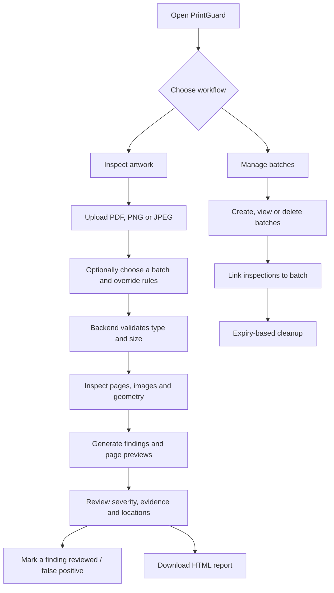
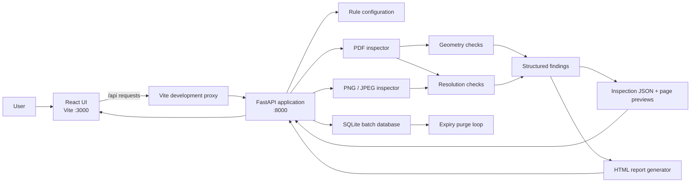
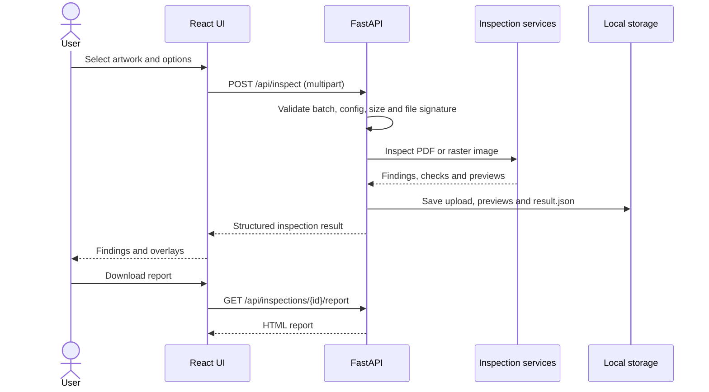

# PrintGuard AI

### Packaging artwork preflight, visual evidence, and batch-aware production checks

[](https://react.dev/) [](https://vitejs.dev/) [](https://fastapi.tiangolo.com/) [](https://www.python.org/) [](https://pytest.org/)

**PrintGuard AI is a packaging preflight assistant that helps teams catch common artwork risks before files reach production.** Upload a PDF, PNG, or JPEG to receive structured findings, visual page previews, severity labels, evidence, recommended actions, and a downloadable HTML report. Optional batch tracking connects inspections to manufacturing and expiry dates.

> **Important:** PrintGuard is a screening aid, not a print-readiness certification. Always validate artwork against the printer's and packaging line's specifications.

---

## The problem

Packaging artwork can look correct on screen and still carry production risks: low-resolution imagery, text placed too close to cut/fold lines, or content positioned outside a safe area. Manual checks are time-consuming and easy to apply inconsistently, especially when multiple products or batches are involved.

## The solution

PrintGuard combines deterministic preflight checks with visual evidence and explicit uncertainty handling. Findings include a severity, measured evidence, an explanation, a recommended action, and a normalized location that the UI can overlay on a page preview. If a check cannot be evaluated from the uploaded file, it is marked **unavailable** rather than silently treated as a pass.

### What it checks today

| Rule ID | Check | Purpose |
|---|---|---|
| `RES-001` | Effective image resolution | Flags raster imagery below configured DPI warning/critical thresholds. |
| `GEOM-001` | Text near cut/fold geometry | Flags text crossing or too close to detected dieline geometry. |
| `SAFE-001` | Safe-area boundary | Flags text outside the configured safe area near the page edge. |

The checks are configurable. Dieline identification can use configured stroke colours and layer names; dashed lines can be treated as probable folds and may require review.

## Product workflow



## Architecture



### Design principles

- **Evidence over a black box:** each finding exposes what was measured and where it was found.
- **Unavailable is not passed:** unsupported or insufficient source data is surfaced honestly.
- **Configurable to production rules:** thresholds and dieline hints can be overridden per inspection.
- **Human review stays in the loop:** findings can be marked as reviewed/false positive; the app does not certify print readiness.
- **Small, local-first prototype:** uploaded artifacts and results are stored locally by default, and batch metadata uses SQLite.

---

## Application features

### Inspect

- Upload PDF, PNG, or JPEG artwork (default maximum upload size: 25 MB).
- Optionally associate the inspection with a batch.
- Override rule settings for a single inspection.
- Review findings by severity and inspect their evidence and page locations.
- View page previews with finding overlays.
- Mark findings as reviewed/false positive.
- Download a standalone HTML report.
- See backend connectivity status in the header.

### Batches

- Create a batch with a batch number, optional product name, manufacturing date, and either expiry date or shelf-life days.
- List batches, open inspections associated with a batch, and delete a batch.
- Trigger an expiry cleanup manually.
- Automatically purge expired batches and linked inspection artifacts at server startup and on a configurable interval. A batch is retained through its expiry date and removed the day after.

### Rule configuration

Default values are loaded from `backend/rules/default_rules.json` and validated in `backend/config.py`.

| Setting | Default / meaning |
|---|---|
| `min_dpi_warning` | `150` DPI warning threshold |
| `min_dpi_critical` | `72` DPI critical threshold |
| `min_clearance_mm` | `3.0` mm text-to-dieline clearance |
| `safe_margin_mm` | `3.0` mm safe-area inset |
| `safe_area_norm` | Optional explicit normalized safe area `[x, y, width, height]`; overrides margin-based area |
| `dieline_colors` | RGB stroke colours (components from `0` to `1`) considered cut/fold lines |
| `color_tolerance` | Colour matching tolerance |
| `dieline_layer_names` | Layer-name hints such as `dieline`, `cut`, `fold`, and `crease` |
| `detect_dashed_as_fold` | Whether dashed lines can be treated as probable folds |
| `image_target_width_mm` | Optional assumed printed width for raster uploads so effective DPI can be estimated |
| `preview_zoom` | Preview rendering scale |
| `max_pages` | Maximum PDF pages to process |

Tune these values to the printer, substrate, finishing process, and packaging specification. Defaults are starting points, not universal print standards.

---

## Technology stack

| Layer | Technology | Responsibility |
|---|---|---|
| Frontend | React 18, Vite, JavaScript, CSS | Upload flow, findings UI, overlays, batches, API status |
| API | FastAPI, Uvicorn, Pydantic | HTTP endpoints, input validation, orchestration, structured response models |
| PDF processing | PyMuPDF | PDF page inspection and preview generation |
| Raster processing | Pillow | PNG/JPEG loading and image inspection |
| Persistence | JSON files + SQLite | Inspection results, uploaded files, previews, batch records and links |
| Reporting | Generated HTML | Portable report download |
| Testing | pytest, HTTPX | API and rule behaviour tests |

---

## Repository structure

```text
Esko/
├── README.md                         # Project overview, setup, architecture and API
├── .gitignore                        # Ignores node_modules, Python cache and virtualenv
├── backend/
│   ├── main.py                       # FastAPI app, endpoints, upload flow, cleanup lifecycle
│   ├── config.py                     # Defaults + per-inspection rule validation
│   ├── schemas.py                    # Finding, status and inspection result models
│   ├── db.py                         # SQLite batches, inspection links and expiry purge
│   ├── requirements.txt              # Python dependencies
│   ├── rules/
│   │   └── default_rules.json        # Default preflight thresholds and dieline hints
│   ├── services/
│   │   ├── __init__.py
│   │   ├── document.py               # Shared document-related helpers
│   │   ├── pdf_inspector.py          # PDF text/geometry inspection and page previews
│   │   ├── image_inspector.py        # PNG/JPEG inspection and previews
│   │   ├── resolution_checks.py      # RES-001 effective-resolution check
│   │   ├── geometry_checks.py        # GEOM-001 and SAFE-001 checks
│   │   ├── report_generator.py       # Downloadable HTML report generation
│   │   └── summary.py                # Finding IDs and result summary helpers
│   └── tests/
│       ├── __init__.py
│       ├── conftest.py               # Test fixtures
│       ├── test_api.py               # API behaviour
│       ├── test_batches.py            # Batch lifecycle and expiry
│       ├── test_geometry.py          # Geometry/safe-area checks
│       └── test_resolution.py        # Resolution checks
└── frontend/
    ├── index.html                    # Vite entry document; mounts React at #root
    ├── package.json                  # Frontend scripts and dependencies
    ├── package-lock.json             # Locked npm dependency tree
    ├── vite.config.js                # Dev server on :3000 and /api proxy to :8000
    └── src/
        ├── main.jsx                  # React bootstrap and stylesheet import
        ├── App.jsx                   # Header, navigation, health state and view routing
        ├── api.js                    # Typed-by-convention API wrapper and error handling
        ├── styles.css                # Application styling
        └── components/
            ├── UploadView.jsx        # File upload and inspection options
            ├── ResultView.jsx        # Findings, page preview, statuses and report link
            └── BatchesView.jsx       # Batch create/list/delete and linked inspections
```

> The tree above describes the current prototype layout. If a file is renamed or added, update this section to keep it in sync with the repository.

---

## Run locally

### Prerequisites

- Python 3.10 or newer
- Node.js and npm
- Git (optional, for cloning)

### 1. Get the code

```bash
git clone https://github.com/Manoj-Barki/Esko.git
cd Esko
```

### 2. Start the backend

Open a terminal in the repository root:

```bash
cd backend
python -m venv .venv
```

Activate the environment:

```powershell
# Windows PowerShell
.\.venv\Scripts\Activate.ps1
```

```bash
# Git Bash / macOS / Linux
source .venv/Scripts/activate  # Windows Git Bash
# On macOS/Linux use: source .venv/bin/activate
```

Install dependencies and start FastAPI:

```bash
pip install -r requirements.txt
uvicorn main:app --reload --port 8000
```

Backend URLs:

- API health: <http://127.0.0.1:8000/api/health>
- Interactive API docs: <http://127.0.0.1:8000/docs>

### 3. Start the frontend

In a second terminal, from the repository root:

```bash
cd frontend
npm install
npm run dev
```

Open <http://localhost:3000>.

The Vite development server proxies `/api` requests to `http://127.0.0.1:8000`. The backend's current CORS configuration allows `http://localhost:3000`, so use that exact frontend origin during local development.

### 4. Run tests

With the backend virtual environment activated:

```bash
cd backend
pytest -q
```

---

## API reference

The backend exposes the following endpoints. Request and response schemas can also be explored at `http://127.0.0.1:8000/docs` while the backend is running.

| Method | Endpoint | Purpose |
|---|---|---|
| `GET` | `/api/health` | Health check used by the frontend connection indicator |
| `POST` | `/api/inspect` | Upload and inspect PDF/PNG/JPEG; accepts multipart `file`, optional JSON-string `config`, optional `batch_id` |
| `GET` | `/api/inspections/{id}` | Retrieve a saved inspection result |
| `GET` | `/api/inspections/{id}/pages/{n}` | Retrieve a rendered page preview (`n` is 1-based) |
| `PATCH` | `/api/inspections/{id}/findings/{finding_id}` | Update finding status, e.g. `{"status":"false_positive"}` |
| `GET` | `/api/inspections/{id}/report` | Download generated HTML report |
| `POST` | `/api/batches` | Create a batch |
| `GET` | `/api/batches` | List batches |
| `GET` | `/api/batches/{batch_id}` | Get a batch by ID |
| `DELETE` | `/api/batches/{batch_id}` | Delete a batch and associated stored inspection data |
| `POST` | `/api/batches/purge-expired` | Manually trigger expiry cleanup |

### Inspection request flow



Finding coordinates use normalized `[x, y, width, height]` values relative to the page, with origin at the top-left. This lets the frontend render overlays at different zoom levels. Page numbering starts at 1.

### Example: create a batch

```http
POST /api/batches
Content-Type: application/json
```

```json
{
  "batch_number": "B-101",
  "product_name": "Example carton",
  "mfg_date": "2026-10-01",
  "shelf_life_days": 180
}
```

Provide either `expiry_date` or `shelf_life_days`. The expiry date must be after the manufacturing date, and batch numbers must be unique.

---

## Storage, privacy and configuration

By default, the backend stores data under a `printguard` directory inside the operating system's temporary folder. This includes uploaded files, inspection result JSON, page previews, and the SQLite database. Temporary storage is convenient for demos, but the OS may clean it up. For persistent local storage, set `PRINTGUARD_STORAGE` before starting the backend.

### Environment variables

| Variable | Default | Purpose |
|---|---|---|
| `PRINTGUARD_STORAGE` | OS temp directory + `printguard` | Root directory for uploads, results, previews and SQLite DB |
| `PRINTGUARD_MAX_MB` | `25` | Maximum accepted upload size in MB |
| `PRINTGUARD_PURGE_MINUTES` | `60` | Interval between automatic expiry purges |
| `VITE_API_BASE` | Empty string | Optional API base URL for a separately hosted frontend; configure backend CORS accordingly |

Example (PowerShell):

```powershell
$env:PRINTGUARD_STORAGE = "C:\printguard-data"
$env:PRINTGUARD_MAX_MB = "25"
$env:PRINTGUARD_PURGE_MINUTES = "60"
uvicorn main:app --reload --port 8000
```

**Privacy note:** treat uploads as production assets. Use only files you are authorized to process, choose a storage location appropriate for their sensitivity, and remember that expiry purge permanently deletes expired batch data and linked inspection artifacts.

---

## Limitations and honest uncertainty

- PNG/JPEG inputs provide visual previews, but vector geometry checks require a PDF with usable vector paths.
- Scanned/image-only PDFs may not contain extractable text; geometry-related checks can therefore be unavailable.
- Raster DPI cannot be reliably inferred without a physical print size. `image_target_width_mm` can supply an assumed width for an estimate.
- Safe-area checks measure from the page edge unless `safe_area_norm` is configured; they do not automatically infer every printer's trim box or bleed specification.
- Dieline colours and layer names must be configured for the source artwork. Dashed-line detection is heuristic and may need human review.
- The default thresholds are not universal standards; calibrate them to the production workflow.
- A passing result does not guarantee colour accuracy, trapping, overprint behaviour, barcode readability, substrate compatibility, or overall print readiness.
- This is a local prototype, not a hardened multi-tenant production service. Review authentication, authorization, storage isolation, deployment configuration, and operational monitoring before exposing it to untrusted networks.

## Troubleshooting

| Symptom | What to check |
|---|---|
| Frontend says “Backend not reachable” | Start the API from `backend/` using `uvicorn main:app --reload --port 8000`; check `/api/health`. |
| Browser page is blank | Confirm `frontend/index.html` exists, includes `<div id="root"></div>`, and loads `/src/main.jsx`; check browser console and Vite terminal. |
| Upload returns `415` | Only PDF, PNG, and JPEG files are supported. |
| Upload returns `413` | File exceeds `PRINTGUARD_MAX_MB` (25 MB by default). |
| Upload returns `422` | The file may be unreadable/corrupt or the optional config JSON may be invalid. |
| Batch creation returns `409` | The batch number already exists. Choose a unique number. |
| Page/report returns `404` | Verify the inspection ID and page number; stored data may have been removed by expiry cleanup. |
| Frontend API requests fail in development | Keep frontend at `http://localhost:3000`; Vite proxies `/api` to port `8000`. |

## Roadmap ideas

Potential next steps for a hackathon demo or future iteration:

- Add representative sample artwork and clearly labelled defect fixtures.
- Add a “before/after” guided demo and a one-click sample inspection.
- Add configurable per-printer profiles and versioned rule sets.
- Add a batch-level summary of inspection outcomes and recurring defect patterns.
- Add export options such as JSON/CSV alongside HTML.
- Add stronger persistence controls, authentication, audit events, and deployment documentation before production use.

These are ideas, not features currently claimed by the prototype.

## Contributing

1. Create a focused branch.
2. Make a small, testable change.
3. Add or update tests for rule/API behaviour.
4. Run `pytest -q` from `backend/` and verify the frontend manually.
5. Update this README when endpoints, rules, storage behaviour, or project structure changes.

## License

No license is specified in this repository yet. Add a `LICENSE` file before redistributing the project or accepting external contributions under explicit terms.

---

**Built for safer packaging preflight workflows.** Catch likely issues earlier, show the evidence, and keep the final production decision with the people and specifications that matter.
